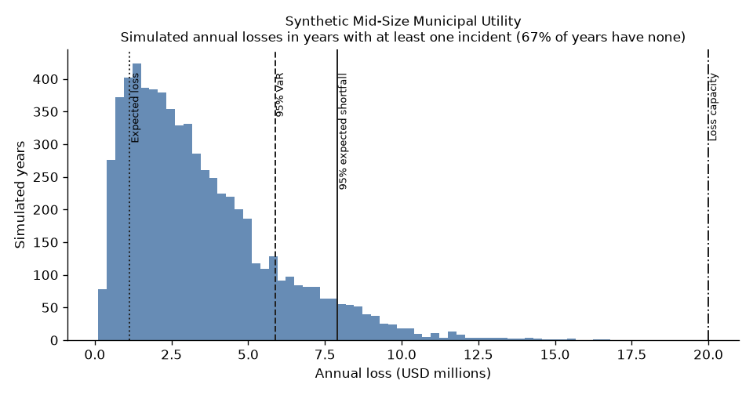

# cfri-lite

**A cyber-financial loss calculator for public water utilities.**

`cfri-lite` answers one question for a water utility's finance office:

> *If we are hit by a cyberattack this year, how much money could we lose, can our reserves absorb it, and which security investment reduces that loss the most?*

It simulates losses from six attack scenarios and measures the worst case against the utility's own reserves. It turns that comparison into a 0–100 **CFRI-lite score**, and it ranks security controls by how much loss each one removes per dollar.

> **Synthetic data only.** Every utility profile in this repository is synthetic. The numbers are illustrative assumptions, not measurements of any real utility. Results show how the method works. They are not estimates for any real system.

---

## What it does

| Step | Output |
|---|---|
| Simulate 20,000 years of attack outcomes (Monte Carlo) | Distribution of annual cyber losses |
| Measure the worst case | Expected loss, 95% value-at-risk, **95% expected shortfall (ES95)** |
| Compare it to the utility's reserves and undrawn liquidity | **CFRI-lite score (0–100)** and five risk tiers |
| Show what drives the worst case | Share of tail loss by scenario |
| Rank security controls | Loss reduction, worst-case reduction and ROI for each control |
| Pick the best set within a budget | Optimal control portfolio, with the score before and after |

**Scoring rule:** `score = 100 × (1 − 5^(−ES95 / loss capacity))`. A worst-case loss equal to the utility's loss capacity scores **80**, which is the start of the highest tier. The same dollar loss scores higher for a small utility than for a large one, because small systems have less room to absorb it.

### The six scenarios

| ID | Scenario | Type |
|---|---|---|
| S1 | Chemical-dosing tampering | Operational |
| S2 | Control-system disruption (forced manual operation) | Operational |
| S3 | Ransomware on IT and billing systems | IT |
| S4 | Sensor and meter data spoofing | Operational |
| S5 | Vendor-payment diversion (business email compromise) | Financial |
| S6 | Customer data breach | IT |

## Sample results (synthetic utilities)

| Synthetic utility | Loss capacity | Worst-case loss (ES95) | Score | Best set within budget | Score after |
|---|---:|---:|---:|---|---:|
| Small rural system (8,000 people) | $1.15M | $0.69M | **61.8** (High) | $40K budget | **31.1** |
| Mid-size municipal (250,000 people) | $20.0M | $7.92M | **47.1** (Elevated) | $400K budget | **21.8** |
| Large metropolitan (1.5M people) | $250M | $40.9M | **23.1** (Guarded) | $1.5M budget | **10.2** |

The small system has the smallest losses in dollars and the highest risk score. Full reports are in [`examples/`](examples/).



## Quick start

```bash
pip install -e ".[dev]"
cfri-lite synth --out data/synthetic
cfri-lite run data/synthetic/mid_size.json --budget 400000 --out reports
```

Without installing:

```bash
PYTHONPATH=src python -m cfri_lite run data/synthetic/mid_size.json --budget 400000 --out reports
```

Options for `run`: `--simulations` (default 20000), `--seed` (default 42, for reproducible results), and `--objective es95|total_cost`. `es95` minimizes the worst-case loss; `total_cost` minimizes expected loss plus control cost.

### Excel version

[`excel/cfri_lite_calculator.xlsx`](excel/cfri_lite_calculator.xlsx) runs the same model with ordinary Excel formulas and no macros. Edit the yellow cells on **Inputs** and **Controls**, set controls to Yes/No, and press **F9**. It simulates 5,000 years, so its results move slightly on each recalculation and agree with the Python model within simulation noise.

To rebuild it from any profile:

```bash
python scripts/build_excel.py data/synthetic/mid_size.json excel/cfri_lite_calculator.xlsx
```

### Use your own figures

Copy a file from `data/synthetic/`, change the reserves, liquidity, scenario probabilities, loss ranges and control costs, and set `"synthetic": false`. The format is documented in [`docs/methodology.md`](docs/methodology.md#input-format).

## Repository layout

```
src/cfri_lite/      model, simulation, index, optimizer, synthetic data, reports, CLI
data/synthetic/     three synthetic utility profiles (JSON)
examples/           generated reports, charts and JSON results
excel/              Excel edition of the calculator
scripts/            Excel builder
tests/              pytest suite
docs/               methodology and limitations
```

## Tests

```bash
pytest
```

The tests check the scoring anchors, the analytic expected loss, the tail measures, control effects, the optimizer's budget limit, the synthetic profiles and the command-line workflow end to end.

## Scope

`cfri-lite` is the open, financial layer of a larger research program on cyber-financial risk in U.S. municipal water infrastructure. It does **not** include real-time data ingestion, machine-learning models, sensor verification, data fusion or federated learning. See [`NOTICE.md`](NOTICE.md).

## Roadmap

- [ ] Annual frequency model (several incidents per year) as an option
- [ ] Correlated scenarios, for example a ransomware attack that also exposes customer data
- [ ] A cyber-risk reserve line for cost-of-service and rate studies
- [ ] A synthetic accounts-payable dataset and a vendor-payment fraud checker
- [ ] Sensitivity analysis and a tornado chart

## Author

Silvia Tsovwen Asakpa, M.S. Applied Financial Economics (Saint Louis University). See [`CITATION.cff`](CITATION.cff).

## License

**Not yet selected.** See [`NOTICE.md`](NOTICE.md). Until a license file is added, all rights are reserved.
