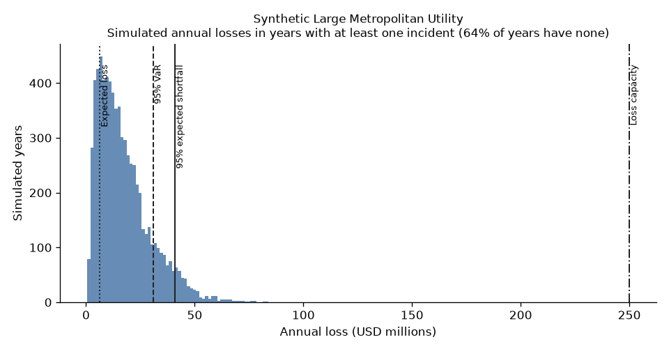

# CFRI-lite Risk Report: Synthetic Large Metropolitan Utility

> **Synthetic data.** This report uses illustrative assumptions, not data from any real utility. It demonstrates the method only.

## Headline

- **CFRI-lite score: 23.1 / 100 (Tier 2 - Guarded)**
- Worst-case loss (average of the worst 5% of years, ES95): **$40.86M**
- Loss capacity (reserves $150.00M + undrawn liquidity $100.00M): **$250.00M**
- The worst-case loss equals **16%** of loss capacity (a ratio of 100% scores 80, the start of the highest tier).
- Expected annual loss: $6.27M; 95% value-at-risk: $31.00M
- Simulations: 20,000

## Which scenarios drive the worst case

| Scenario | Annual probability | Expected annual loss | Share of worst-case loss |
|---|---:|---:|---:|
| S3 Ransomware on IT and billing systems | 11.0% | $2.42M | 56% |
| S1 Chemical-dosing tampering | 2.2% | $520K | 16% |
| S2 Control-system disruption (forced manual operation) | 5.5% | $904K | 13% |
| S5 Vendor-payment diversion (business email compromise) | 13.2% | $1.27M | 7% |
| S6 Customer data breach | 6.6% | $795K | 6% |
| S4 Sensor and meter data spoofing | 4.4% | $361K | 2% |

## Security investments ranked

Each control evaluated on its own against no controls. Ranked by worst-case loss reduction per dollar.

| Control | Annual cost | Expected loss reduction | Worst-case (ES95) reduction | ROI on expected loss |
|---|---:|---:|---:|---:|
| C7 Phishing-resistant staff training | $100K | $1.02M | $2.40M | +920% |
| C4 Vendor bank-detail call-back verification | $60K | $870K | $1.29M | +1351% |
| C3 Offline backups with tested restores | $480K | $1.39M | $10.06M | +189% |
| C8 Cyber insurance (net of deductible) | $720K | $2.19M | $14.30M | +205% |
| C1 Multi-factor authentication on remote access | $240K | $1.33M | $4.31M | +456% |
| C5 PLC setpoint limits and safety interlocks | $320K | $349K | $2.52M | +9% |
| C6 24/7 security monitoring and response | $1.20M | $1.59M | $8.74M | +33% |
| C2 OT/IT network segmentation | $1.00M | $1.21M | $6.89M | +21% |

## Best control set within a $1.50M annual budget

Objective: lowest worst-case loss (ES95). Search: exhaustive.

- Selected: C1 Multi-factor authentication on remote access, C3 Offline backups with tested restores, C4 Vendor bank-detail call-back verification, C8 Cyber insurance (net of deductible)
- Annual cost: $1.50M
- Score: **23.1 -> 10.2** (worst-case loss $40.86M -> $16.76M)
- Expected annual loss: $6.27M -> $2.02M

## How to read the score

| Score | Tier |
|---|---|
| 0 - 20 | Tier 1 - Low |
| 20 - 40 | Tier 2 - Guarded |
| 40 - 60 | Tier 3 - Elevated |
| 60 - 80 | Tier 4 - High |
| 80 - 100 | Tier 5 - Severe |

Method: see `docs/methodology.md`. This is a planning model, not a forecast.
