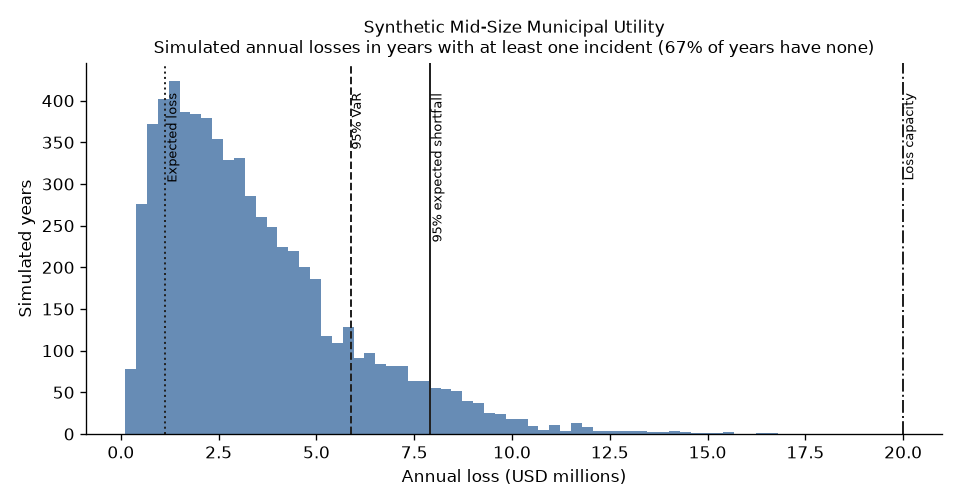

# CFRI-lite Risk Report: Synthetic Mid-Size Municipal Utility

> **Synthetic data.** This report uses illustrative assumptions, not data from any real utility. It demonstrates the method only.

## Headline

- **CFRI-lite score: 47.1 / 100 (Tier 3 - Elevated)**
- Worst-case loss (average of the worst 5% of years, ES95): **$7.92M**
- Loss capacity (reserves $15.00M + undrawn liquidity $5.00M): **$20.00M**
- The worst-case loss equals **40%** of loss capacity (a ratio of 100% scores 80, the start of the highest tier).
- Expected annual loss: $1.14M; 95% value-at-risk: $5.88M
- Simulations: 20,000

## Which scenarios drive the worst case

| Scenario | Annual probability | Expected annual loss | Share of worst-case loss |
|---|---:|---:|---:|
| S3 Ransomware on IT and billing systems | 10.0% | $434K | 56% |
| S1 Chemical-dosing tampering | 2.0% | $98K | 16% |
| S2 Control-system disruption (forced manual operation) | 5.0% | $164K | 14% |
| S5 Vendor-payment diversion (business email compromise) | 12.0% | $233K | 7% |
| S6 Customer data breach | 6.0% | $145K | 6% |
| S4 Sensor and meter data spoofing | 4.0% | $65K | 2% |

## Security investments ranked

Each control evaluated on its own against no controls. Ranked by worst-case loss reduction per dollar.

| Control | Annual cost | Expected loss reduction | Worst-case (ES95) reduction | ROI on expected loss |
|---|---:|---:|---:|---:|
| C7 Phishing-resistant staff training | $25K | $179K | $429K | +615% |
| C3 Offline backups with tested restores | $120K | $250K | $1.96M | +108% |
| C4 Vendor bank-detail call-back verification | $15K | $159K | $235K | +958% |
| C1 Multi-factor authentication on remote access | $60K | $244K | $928K | +306% |
| C8 Cyber insurance (net of deductible) | $180K | $399K | $2.77M | +122% |
| C5 PLC setpoint limits and safety interlocks | $80K | $67K | $490K | -16% |
| C6 24/7 security monitoring and response | $300K | $282K | $1.69M | -6% |
| C2 OT/IT network segmentation | $250K | $218K | $1.34M | -13% |

## Best control set within a $400K annual budget

Objective: lowest worst-case loss (ES95). Search: exhaustive.

- Selected: C1 Multi-factor authentication on remote access, C3 Offline backups with tested restores, C4 Vendor bank-detail call-back verification, C7 Phishing-resistant staff training, C8 Cyber insurance (net of deductible)
- Annual cost: $400K
- Score: **47.1 -> 21.8** (worst-case loss $7.92M -> $3.06M)
- Expected annual loss: $1.14M -> $314K

## How to read the score

| Score | Tier |
|---|---|
| 0 - 20 | Tier 1 - Low |
| 20 - 40 | Tier 2 - Guarded |
| 40 - 60 | Tier 3 - Elevated |
| 60 - 80 | Tier 4 - High |
| 80 - 100 | Tier 5 - Severe |

Method: see `docs/methodology.md`. This is a planning model, not a forecast.
