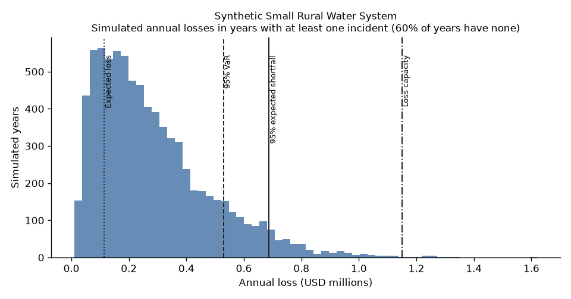

# CFRI-lite Risk Report: Synthetic Small Rural Water System

> **Synthetic data.** This report uses illustrative assumptions, not data from any real utility. It demonstrates the method only.

## Headline

- **CFRI-lite score: 61.8 / 100 (Tier 4 - High)**
- Worst-case loss (average of the worst 5% of years, ES95): **$687K**
- Loss capacity (reserves $900K + undrawn liquidity $250K): **$1.15M**
- The worst-case loss equals **60%** of loss capacity (a ratio of 100% scores 80, the start of the highest tier).
- Expected annual loss: $114K; 95% value-at-risk: $529K
- Simulations: 20,000

## Which scenarios drive the worst case

| Scenario | Annual probability | Expected annual loss | Share of worst-case loss |
|---|---:|---:|---:|
| S3 Ransomware on IT and billing systems | 12.5% | $45K | 55% |
| S1 Chemical-dosing tampering | 2.5% | $10K | 16% |
| S2 Control-system disruption (forced manual operation) | 6.2% | $16K | 12% |
| S5 Vendor-payment diversion (business email compromise) | 15.0% | $23K | 8% |
| S6 Customer data breach | 7.5% | $14K | 7% |
| S4 Sensor and meter data spoofing | 5.0% | $6K | 2% |

## Security investments ranked

Each control evaluated on its own against no controls. Ranked by worst-case loss reduction per dollar.

| Control | Annual cost | Expected loss reduction | Worst-case (ES95) reduction | ROI on expected loss |
|---|---:|---:|---:|---:|
| C7 Phishing-resistant staff training | $2K | $19K | $43K | +672% |
| C4 Vendor bank-detail call-back verification | $2K | $16K | $23K | +940% |
| C3 Offline backups with tested restores | $12K | $26K | $166K | +113% |
| C8 Cyber insurance (net of deductible) | $18K | $40K | $240K | +122% |
| C1 Multi-factor authentication on remote access | $6K | $26K | $77K | +326% |
| C5 PLC setpoint limits and safety interlocks | $8K | $7K | $42K | -19% |
| C6 24/7 security monitoring and response | $30K | $30K | $151K | -1% |
| C2 OT/IT network segmentation | $25K | $22K | $117K | -13% |

## Best control set within a $40K annual budget

Objective: lowest worst-case loss (ES95). Search: exhaustive.

- Selected: C1 Multi-factor authentication on remote access, C3 Offline backups with tested restores, C4 Vendor bank-detail call-back verification, C7 Phishing-resistant staff training, C8 Cyber insurance (net of deductible)
- Annual cost: $40K
- Score: **61.8 -> 31.1** (worst-case loss $687K -> $267K)
- Expected annual loss: $114K -> $31K

## How to read the score

| Score | Tier |
|---|---|
| 0 - 20 | Tier 1 - Low |
| 20 - 40 | Tier 2 - Guarded |
| 40 - 60 | Tier 3 - Elevated |
| 60 - 80 | Tier 4 - High |
| 80 - 100 | Tier 5 - Severe |

Method: see `docs/methodology.md`. This is a planning model, not a forecast.
